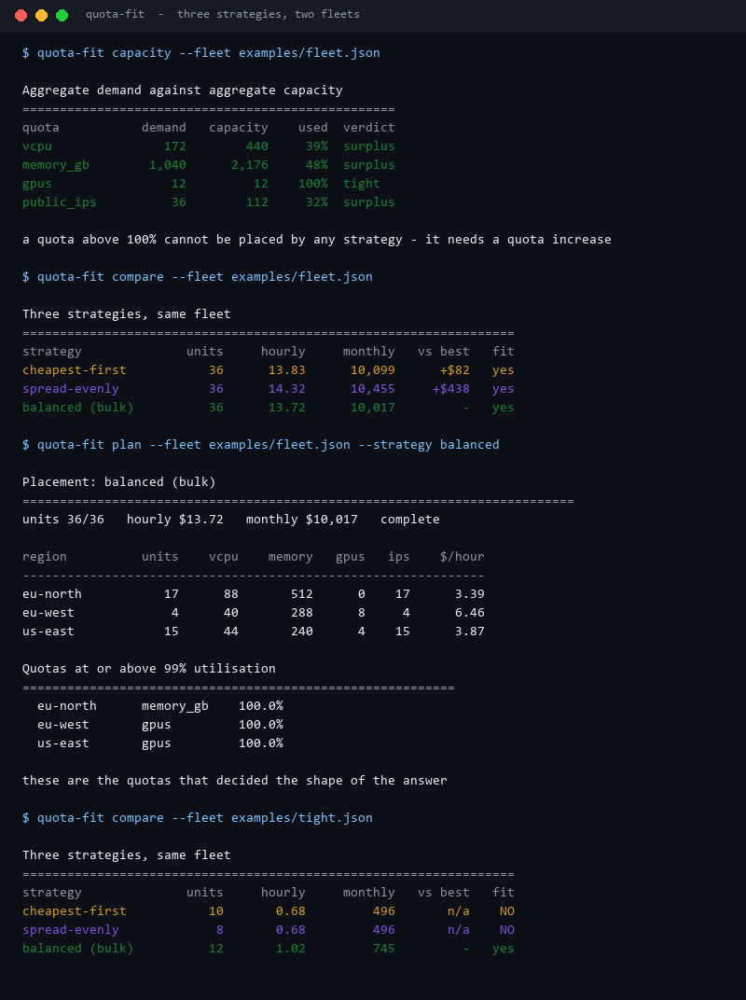
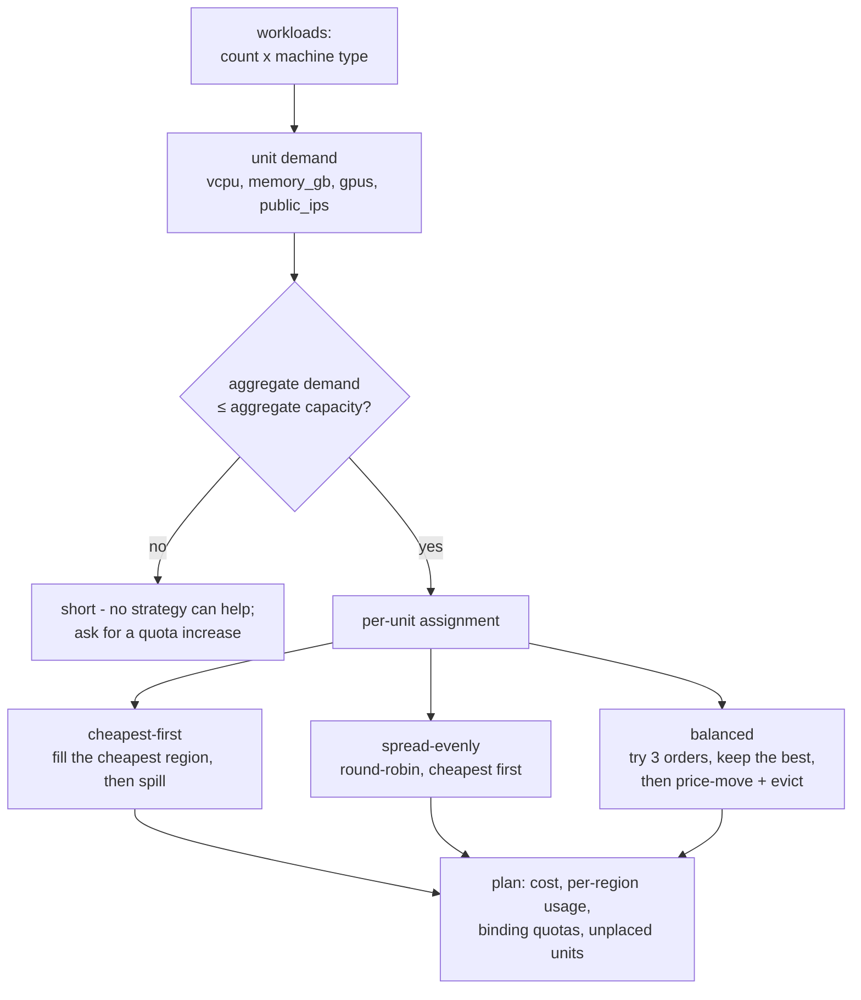
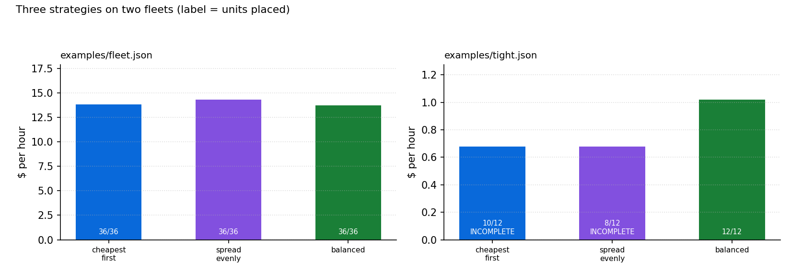
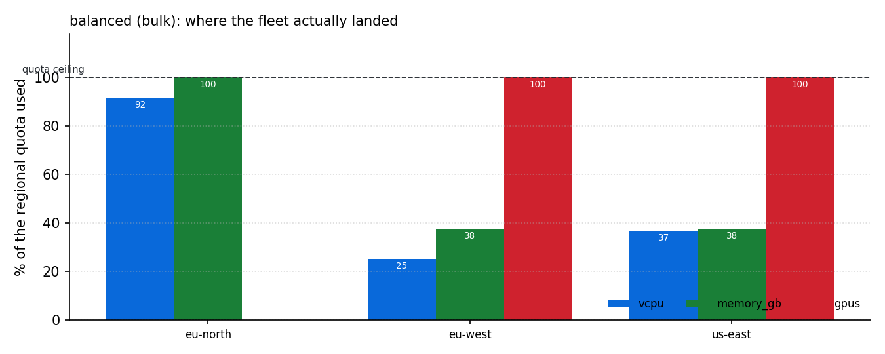

# Quota-Fit-Planner

**You asked for 36 machines. Which regions can actually hold them, which quota runs out first, and what does each placement strategy cost?**

Every cloud account has a ceiling per region: vCPUs, memory, GPUs, public IPs. A fleet that fits on
paper does not fit in a region whose GPU quota is already spent. This places a requested fleet under
those ceilings, compares three strategies a human would actually choose between, and names the
quota that decided the answer.



All numbers come from `scripts/render_assets.py` running this repository's code on the committed
example fleets.

---

## Table of contents

- [Why this exists](#why-this-exists)
- [The problem in one diagram](#the-problem-in-one-diagram)
- [Aggregate capacity is not the answer](#aggregate-capacity-is-not-the-answer)
- [Three strategies, measured](#three-strategies-measured)
- [Where the fleet actually landed](#where-the-fleet-actually-landed)
- [The tight case where greedy fails](#the-tight-case-where-greedy-fails)
- [The case no strategy can save](#the-case-no-strategy-can-save)
- [Install and run](#install-and-run)
- [Commands](#commands)
- [Fleet file format](#fleet-file-format)
- [Design notes and limits](#design-notes-and-limits)
- [Tests](#tests)
- [License](#license)

---

## Why this exists

Capacity planning usually stops at "add up the vCPUs and compare to the total quota". That check
passes and the deploy still fails, because quotas are **per region and per dimension**, and a unit
needs all of its dimensions from the *same* region. A region with 100 free vCPUs and no free GPU
cannot host a training node no matter how the arithmetic looks.

Three questions are worth answering before asking anyone for a quota increase:

1. **Is the fleet placeable at all?** Not in aggregate - per region, per dimension, honouring
   `allowed_for` and pinned workloads.
2. **What does each strategy cost?** Cheapest-first, spread-evenly, and a repaired greedy are three
   different answers, and the gap between them is usually larger than the price difference between
   the regions.
3. **Which quota decided the shape of the answer?** A plan where eu-west sits at exactly 100% GPU
   utilisation is a plan that is one instance away from unplaceable, and that is worth knowing.

## The problem in one diagram



The hard part is the middle box: a unit must take **all four dimensions from one region**, so this
is multi-dimensional generalised assignment (NP-hard). The tool does not claim to find the optimum -
it runs three heuristics a person would pick between, and reports the gap between them honestly.

## Aggregate capacity is not the answer

```
$ quota-fit capacity --fleet examples/fleet.json
quota           demand   capacity    used  verdict
vcpu               172        440     39%  surplus
memory_gb        1,040      2,176     48%  surplus
gpus                12         12    100%  tight
public_ips          36        112     32%  surplus
```

Three dimensions have plenty of headroom and **GPUs are at exactly 100%**. 12 GPUs of demand against
12 GPUs of quota across four regions is not "surplus" by any useful definition: it means the fleet is
placeable only if every GPU lands in a region that has GPUs, and one extra training node makes the
whole plan impossible.

That is why the tool reports the *binding* quotas next to the totals rather than instead of them:

```
Quotas at or above 99% utilisation
  eu-north      memory_gb    100.0%
  eu-west       gpus         100.0%
  us-east       gpus         100.0%
```

## Three strategies, measured



`examples/fleet.json` - 5 workloads, 36 units, 4 regions:

| Strategy | Units placed | $/hour | $/month | vs best |
| --- | ---: | ---: | ---: | ---: |
| cheapest-first | 36/36 | 13.83 | 10,099 | +$82 |
| spread-evenly | 36/36 | 14.32 | 10,455 | +$438 |
| **balanced** | 36/36 | **13.72** | **10,017** | **-** |

Two things worth reading carefully:

- **Spreading evenly costs 4.3% more** - $438 a month - for a habit that sounds prudent. Round-robin
  placement puts units in expensive regions that were never needed, because the point of a region is
  to be filled while it is cheap, not to be kept half-empty.
- **The repair pass finds $82 a month** that plain greedy misses. That is small in percentage terms
  and it is free: it is a single-unit price move, not a re-plan.

The honest framing: on a fleet with comfortable headroom, all three strategies work and the gap is a
few percent. The strategies stop being interchangeable when capacity is tight, which is the next
section.

## Where the fleet actually landed



The balanced plan for `examples/fleet.json`:

| Region | Units | vCPU | Memory | GPUs | Public IPs | $/hour |
| --- | ---: | ---: | ---: | ---: | ---: | ---: |
| eu-north | 17 | 88 | 512 | 0 | 17 | 3.39 |
| eu-west | 4 | 40 | 288 | 8 | 4 | 6.46 |
| us-east | 15 | 44 | 240 | 4 | 15 | 3.87 |

The shape is exactly what the constraints dictate:

- **eu-north is the cheap region** (price index 0.82) and it takes 17 of the 36 units - but it has
  **no GPUs at all**, and `allowed_for` restricts it to web/app/db anyway.
- **eu-west has 8 GPUs and gets exactly 8** - 2 of the 3 training nodes, plus the 2 residency-pinned
  units that are not allowed to leave.
- **us-east absorbs the third trainer** and the remaining web/app units at price index 0.91.

Note that eu-west is the *most expensive* region in the plan ($6.46/hour for 4 units) - because GPUs
are expensive and that is where they had to go. A cost-only view would call that a bad region; a
constraint-aware view calls it the only possible one.

## The tight case where greedy fails

`examples/tight.json` is a two-region fleet with exactly enough capacity and no slack:

| Strategy | Units placed | $/hour | Fit |
| --- | ---: | ---: | --- |
| cheapest-first | **10/12** | 0.68 | ✗ 2 units stranded |
| spread-evenly | **8/12** | 0.68 | ✗ 4 units stranded |
| **balanced (bulk)** | **12/12** | 1.02 | ✓ |

Cheapest-first sorts workloads by **unit count** and places eight small web units first, which fills
the cheap region's 16 vCPU exactly. The four 32 GB app units then need memory the cheap region no
longer has, and the dear region only has 64 GB - room for two of them. Two units are stranded.

Balanced tries a different order as well: **largest unit first**. Then the four app units take the
cheap region's 128 GB of memory (16 vCPU exactly), and the eight web units fit the dear region's
16 vCPU / 64 GB exactly. Twelve of twelve, at $1.02/hour.

The stranded greedy plan looks *cheaper* ($0.68/hour) and is worthless, because it delivers 10 of
the 12 machines that were asked for. That is why `plan` exits non-zero when anything is unplaced:
an incomplete plan is not a cheaper plan, it is a failed one.

## The case no strategy can save

`examples/squeeze.json` is the same idea taken one step further: two regions, 40 vCPU and 160 GB
between them, and a fleet that needs 36 vCPU but **176 GB**. The memory demand is 110% of what
exists, so the question is not which strategy is cleverest - it is whether the fleet is placeable at
all, and the tool answers that separately:

```console
$ quota-fit capacity --fleet examples/squeeze.json
quota           demand   capacity    used  verdict
vcpu                36         40     90%  tight
memory_gb          176        160    110%  SHORT
gpus                 2          8     25%  surplus
public_ips          12         20     60%  surplus

a quota above 100% cannot be placed by any strategy - it needs a quota increase
```

All three strategies then agree, and all three are incomplete:

| Strategy | Units placed | $/hour | What is left over |
| --- | ---: | ---: | --- |
| cheapest-first | **11/12** | 0.84 | the GPU trainer |
| spread-evenly | **10/12** | 2.33 | 2 web units |
| balanced | **11/12** | 0.84 | the GPU trainer |

This is the more common production failure of the two. `cheapest-first` and `balanced` actually place
within capacity - they are defeated by the `allowed_for` restriction, not by the quota - while
`spread-evenly` scatters web units into the region that only has room for a third of them. Reading
the capacity table first turns an hour of strategy comparison into a one-line answer: buy more
memory.

## Install and run

Standard library only at runtime.

```bash
python -m pip install -e ".[dev]"
quota-fit compare --fleet examples/fleet.json
```

From a checkout without installing:

```bash
PYTHONPATH=src python -m quota_fit_planner compare --fleet examples/fleet.json
```

## Commands

| Command | What it answers |
| --- | --- |
| `capacity` | aggregate demand vs aggregate capacity, per dimension; exits 1 on a real shortage |
| `compare` | all three strategies with the monthly gap |
| `plan [--strategy cheapest\|spread\|balanced]` | one placement with per-region usage; exits 1 if incomplete |
| `binding` | which quotas are at or above 99% |
| `regions` / `workloads` | the inputs, with quotas and total demand |
| `export --out FILE` | the placement as JSON, unit by unit |

## Fleet file format

```json
{
  "hours_per_month": 730,
  "machine_types": [
    { "name": "gpu-train", "vcpu": 16, "memory_gb": 128, "gpus": 4, "hourly_usd": 3.06 }
  ],
  "regions": [
    { "name": "eu-west", "price_index": 1.0,
      "quotas": { "vcpu": 160, "memory_gb": 768, "gpus": 8, "public_ips": 40 } }
  ],
  "workloads": [
    { "name": "gpu", "machine": "gpu-train", "count": 3 },
    { "name": "residency", "machine": "app-medium", "count": 2, "pinned_region": "eu-west" }
  ]
}
```

- **`price_index`** multiplies the machine's base `hourly_usd`, so one price list serves every region.
- **`quotas`** must name only the four supported dimensions; an unknown key is an error rather than
  a silently ignored constraint.
- **`allowed_for`** on a region restricts it to the listed workloads (region features, licenses,
  data-residency rules). An empty list means "anything".
- **`pinned_region`** on a workload removes every other candidate.
- **`hours_per_month`** is only used to turn the hourly figure into a monthly one; nothing else
  depends on it.

## Design notes and limits

- **Heuristics, not an optimum.** The tool does not solve the integer program. `balanced` tries three
  workload orders and keeps the best; on adversarial fleets a true optimum could still be cheaper.
  The value it provides is a *complete* plan and a named bottleneck, not a proof of minimality.
- **Units are indivisible.** A 16 vCPU machine cannot be split across two regions, which is the
  constraint that makes greedy fail. Real reservations sometimes can be, and that is a different
  problem.
- **Quotas are hard and static.** No quota-increase request simulation, no burst, no spot capacity,
  no per-zone breakdown inside a region.
- **One fleet at a time.** Existing usage in a region is not modelled - import your current
  consumption as an extra pinned workload if you need it.
- **Prices are a single hourly number per machine type.** Data transfer, storage, licensing and
  committed-use discounts are out of scope; the tool is about *fitting*, not about invoicing.

## Tests

```bash
PYTHONPATH=src python -m pytest -q     # 67 passed
python -m ruff check .                 # All checks passed!
```

67 tests cover parsing and every rejection path (unknown quota key, negative quota, duplicate
region, unknown machine, bad pin, non-positive price index), unit cost and demand arithmetic,
candidate ordering with `allowed_for` and pins, quota never being exceeded by any strategy, the
tight fleet where greedy strands two units and balanced does not, shortage detection, every report,
and every CLI command and exit code.

## License

MIT. See [LICENSE](LICENSE).

---

<sub>Screenshots and charts are generated by `scripts/render_assets.py` from this repository's own
output. All fleets and prices are synthetic; no third-party images are used.</sub>
